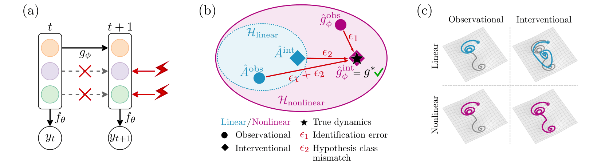
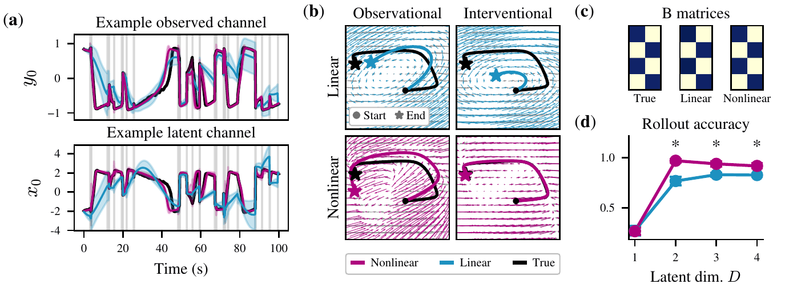
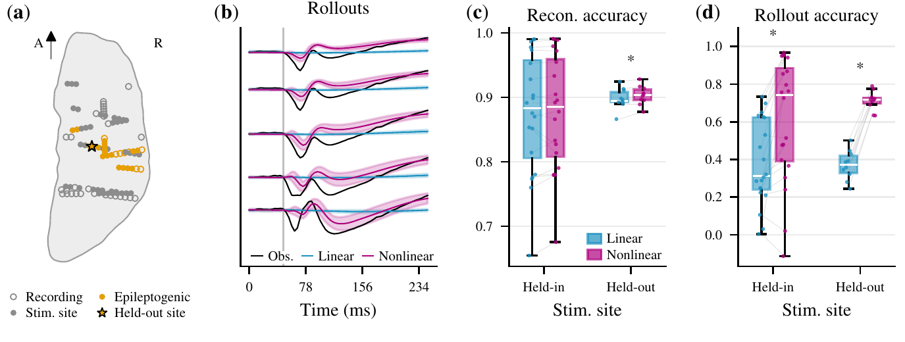

```text
   <-\_/\_/\_
     \  __  /\
      ||  || ´`

This is camel, our mascot. Its full name is CAusal Modelling with Explainable Latents. 
```

# Nonlinear interventional state space models

[](https://arxiv.org/abs/2611.08113)
[](LICENSE)

Code for *Identifying Neural Dynamics Using Nonlinear Interventional State Space Models*
(Tolle, Balsells-Rodas, Wang, Mediano & Nejatbakhsh, 2026).

<p align="center">
  
</p>

*(a) do-interventions fix driven latents to the input value, cutting their dependence on the past. (b) SSMs can miss the true dynamics g∗ through identification error (ε₁, resolved by
interventions) or hypothesis-class mismatch (ε₂, resolved by a nonlinear model class).
(c) Only nonlinear iSSM trained on interventional data recovers the true trajectory (gray).*

State space models recover low-dimensional latent dynamics from high-dimensional neural recordings, but latents are generally not identifiable from observations alone: many different dynamics explain the data equally well. Prior work introduced **interventional state-space models (iSSM)** (Nejatbakhsh & Wang, 2025; Fig. 1a), which leverage do-interventions to break this symmetry. However, the original iSSM framework assumed linear latent dynamics and piecewise-linear observation functions. 

We show that recovering latents requires both (1) hard interventions, and (2) a sufficiently expressive model hypothesis class that includes the true system (Fig 1b-c). We then generalize the original iSSM identifiability guarantees, establishing that iSSM latents remain identifiable, up to permutation, scaling and shift, with **nonlinear latent dynamics and general injective emissions**. 

This repository trains and evaluates iSSMs on synthetic dynamical systems and on two stimulation datasets: macaque prefrontal micro-stimulation and human intracranial single-pulse electrical stimulation.

## The model

Latents $x_t \in \mathbb{R}^D$ generate observations $y_t \in \mathbb{R}^N$ and are driven by
stimulation inputs $u_t \in \mathbb{R}^M$:

$$
y_t \sim P\big(y_t \mid f_\theta(x_t)\big), \qquad
x_{t+1} = m_t \odot g_\phi(x_t) + B u_t + \varepsilon_t ,
$$

where $m_{t,j} = 0$ if latent $j$ is driven by the input ($(B u_t)_j \neq 0$) and $1$ otherwise.
The emission $f_\theta$ is a residual MLP, the dynamics $g_\phi$ are linear or an MLP, the process
noise $\varepsilon_t$ is Gaussian, and the likelihood is Gaussian or Poisson in this codebase. An LSTM recognition network $q(x \mid y, u)$ is trained jointly with the generative model by maximising the ELBO.

Models are primarily evaluated on **causal rollouts**: the model infers only the initial state and then generates the rest of the trial from its dynamics and the known stimulation. We additionally use reconstruction accuracy for evaluation, which is commonly used but acausal (not forecasting); it is therefore the easier metric.

## Example results

<p align="center">
  
</p>

*FitzHugh-Nagumo simulations. (a) Rollout of an example observed and latent channel on a test trial
(mean ± s.d. across 10 seeds; gray lines mark stimulation). (b) Learned flow fields of linear and
nonlinear iSSMs trained on observational or interventional data; only the nonlinear model trained
with interventions recovers the true dynamics (black). (c) Inferred input matrices B. (d) Rollout
accuracy across the model's latent dimension; the true dimension is D = 2.*

<p align="center">
  
</p>

*Human iEEG with single-pulse electrical stimulation. The nonlinear iSSM predicts responses to
stimulation more accurately than the original iSSM with linear latent dynamics, including at a stimulation site held out from training. (a) Recording contacts, stimulation sites and the held-out site. (b) Rollouts for a trial at the held-out site (mean ± s.d. across seeds). (c, d) Reconstruction and rollout accuracy at held-in and held-out sites.*

## Installation

```bash
conda env create -f environment.yml          # creates the "camel" environment
conda activate camel
```

All commands below are run from the repository root. A GPU is used when available
(`"device": "auto"` in the configs); everything also runs on CPU.

## Quick start

Train one nonlinear iSSM (D = 2) on the FitzHugh-Nagumo system and evaluate it:

```bash
python -m src.experiments.run_ex -x TrainISSM -c configs/toymodels/fitzhugh_nagumo.json \
    -j 1 -o outputs/quickstart --group_seeds --seed_idx 0

python -m src.experiments.run_ex -x EvalISSM \
    -s group_dir=outputs/quickstart/job_1 \
    -s use_default_output_dir=false -o outputs/quickstart/job_1/eval
```

`-j` picks one value of the config's sweep axes (here `D = [1, 2, 3, 4]`), and `-s KEY=VALUE`
overrides a setting, e.g. `-s n_epochs=50` for a quick test. The trained model is written to
`outputs/quickstart/job_1/seed_000/` and the evaluation metrics to `outputs/quickstart/job_1/eval/`.

## Reproducing the paper

Each analysis has a job suite under `job_scripts/` with its own README. A suite trains every model
it needs (10 seeds each), evaluates it, and writes the figures and statistics to `figures/<name>/`.

| Result (arXiv v1) | Job suite | Figure script |
|---|---|---|
| Fig. 1c: identifiability schematic | – | `figure_conceptual` |
| Fig. 2 and supplement: FitzHugh-Nagumo / Van der Pol | `toymodels` | `figure_toymodels` |
| Fig. 3: decision-making models | `decision_models` | `figure_decision_models` |
| Fig. 4 and supplement: macaque | `realdata` | `figure_realdata` |
| Fig. 5 and supplement: human iEEG | `realdata` | `figure_huang` |
| Fig. 6 and supplement: amount and design of interventions | `stimulation_protocol` (+ `decision_models`) | `figure_interventions` |
| Supplement: intervention hardness | `intervention_hardness` | `figure_hardness` |

```bash
bash job_scripts/toymodels/run.sh --mode local               # everything, sequentially
bash job_scripts/toymodels/run.sh --mode pbs                 # PBS array jobs with dependencies
bash job_scripts/toymodels/run.sh --stage figures            # figures from existing outputs
N_SEEDS=1 N_EPOCHS=2 JOBS=1 bash job_scripts/toymodels/run.sh --stage train   # quick smoke test
```

Figure scripts run as `python -m scripts.figures.<script>`. Outputs are written to
`outputs/<analysis>/<system>/<model>/job_<k>/seed_<NNN>/`, with the evaluation of each group of
seeds in `job_<k>/eval/`. Evaluation always uses the registry defaults, except for the
intervention-hardness analysis (`latent_alignment=corr`).

## Data

**Synthetic systems** are simulated on the fly from the configs.

**Human iEEG** (single-pulse electrical stimulation; OpenNeuro
[ds004457](https://openneuro.org/datasets/ds004457)). Only subject `sub-2` is used (about 2 GB):

```bash
aws s3 sync --no-sign-request s3://openneuro.org/ds004457 data/huang_2023/raw \
    --exclude "*" --include "sub-2/*" --include "*.json" --include "*.tsv"

conda env create -f environment_preproc.yml       # pymef + mne, only for this step
conda run -n camel_preproc python -m scripts.huang.preprocess --subject sub-2
```

This writes the epoched recordings to `data/huang_2023/preproc/sub-2/`, where the Huang configs
and figure script expect them.

**Macaque micro-stimulation** recordings (Nejatbakhsh et al., 2023) are not publicly available;
they were shared with us by collaborators. If you are interested in this dataset, please get in
touch with the authors. The loader (`src/datasets/kiani.py`) and configs are included; they expect
the session files (`*.PAG.mat`) in `data/macaque/`.

## Repository structure

```
configs/          training configs, one per model and system (list-valued fields are sweep axes)
job_scripts/      one pipeline per analysis: train -> evaluate -> figures (local or PBS)
scripts/figures/  figure scripts; each writes the figure and its statistics
scripts/huang/    preprocessing of the raw human iEEG recordings
src/
  experiments/    experiment entry point (run_ex.py), training, evaluation, virtual stimulation
  models/         recognition network, latent dynamics, emission and likelihood
  simulations/    synthetic dynamical systems and stimulation protocols
  datasets/       data loaders for the synthetic and real datasets
  training/       ELBO, optimisation loop, early stopping
  utils/          metrics, statistics, plotting, I/O
```

Configs contain top-level fields (`seed`, `output_dir`, `device`, `logging`) and `settings` and
`components` dicts. Defaults and required fields are defined in
`src/experiments/cfg_registries/{settings,components}.json`; a setting such as `D` propagates to
every component that accepts it.

## Citation

```bibtex
@article{tolle2026identifying,
  title   = {Identifying Neural Dynamics Using Nonlinear Interventional State Space Models},
  author  = {Tolle, Hanna M. and Balsells-Rodas, Carles and Wang, Yixin and
             Mediano, Pedro A. M. and Nejatbakhsh, Amin},
  journal = {arXiv preprint arXiv:2611.08113},
  year    = {2026}
}
```

## Acknowledgements

This codebase is a PyTorch reimplementation and extension of the interventional state space model
(iSSM) framework of Nejatbakhsh & Wang (2025); their original JAX implementation is available at
[github.com/amin-nejat/issm](https://github.com/amin-nejat/issm).

## License

BSD 3-Clause (see `LICENSE`).
